



<a href="https://github.com/Sambarlasagna/Connected-Fleet-Telemetry-Predictive-Maintenance"></a>
<a href="https://github.com/Sambarlasagna/Behavioral-Cloning-for-Steering-Angle-Prediction"></a>
<a href="https://github.com/Sambarlasagna/AutoNotes-Pro"></a>
<a href="https://github.com/Sambarlasagna/CineScope"></a>
<a href="https://github.com/Sambarlasagna/Counterfactual-Vision-Auditor"></a>




  
  
  <a href="https://leetcode.com/Jayashuriya/"></a>
  <a href="https://www.hackerrank.com/profile/jayatech911"></a>


